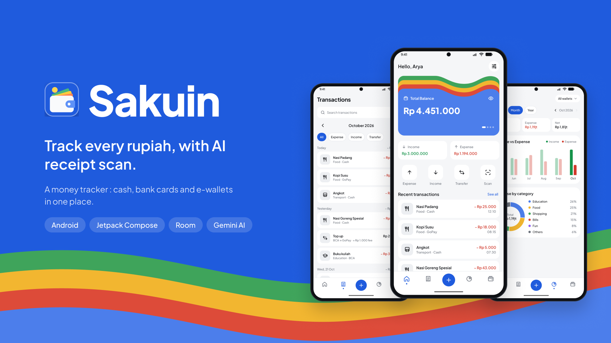
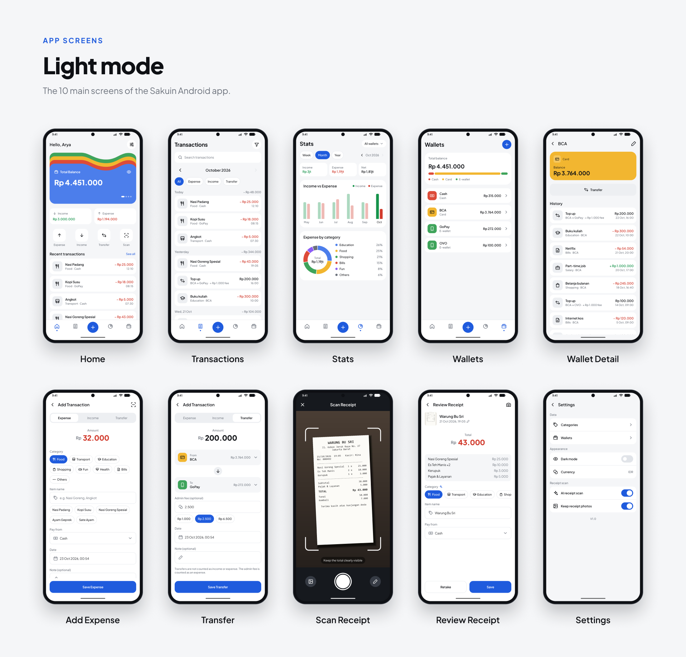
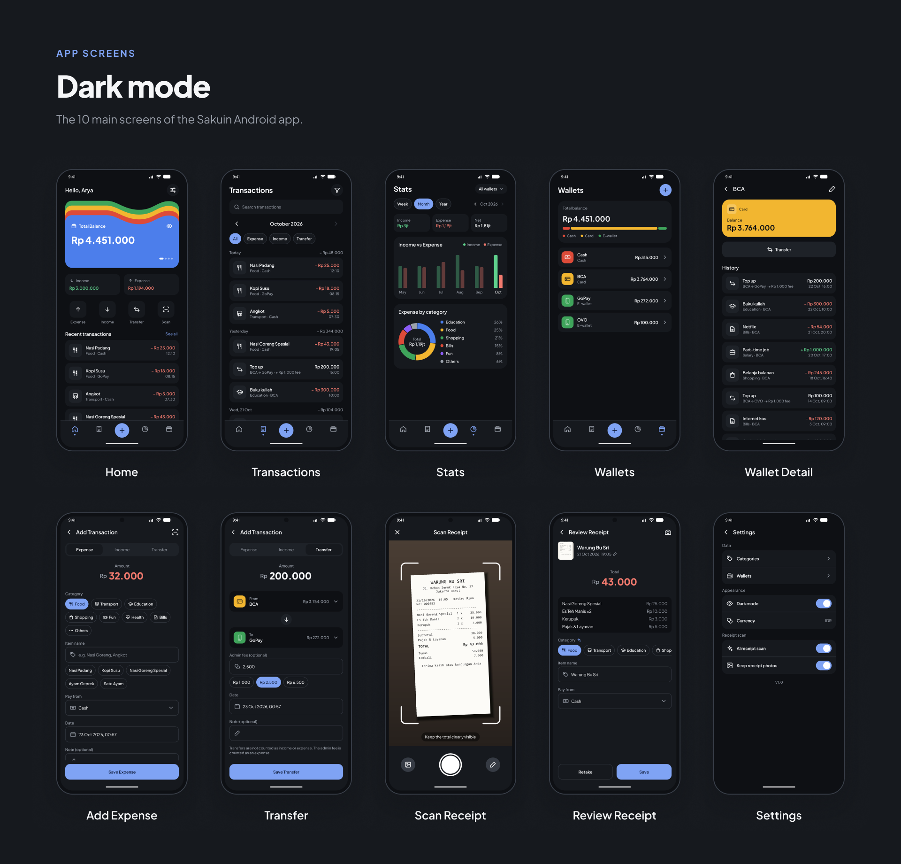
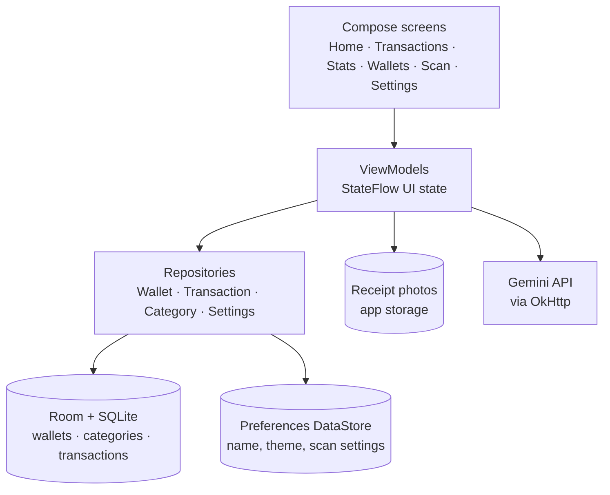

<p align="center">
  
</p>

# Sakuin

Sakuin is an Android money tracker that keeps cash, bank cards and e-wallets in one place. Users record money in, money out and transfers between wallets, see their total balance, and understand their spending through charts. All data stays on the phone and the core features work without internet. The only online feature is receipt scanning: Gemini reads a photo of a receipt and fills in the expense for you.

Sakuin is a side project I designed and built on my own, from the UI design in Figma to the Android app.

- **Platform:** Android 7.0+ (minSdk 24, targetSdk 36)
- **Language:** Kotlin, Jetpack Compose
- **UI language:** English, amounts in Indonesian Rupiah

## Features

### Wallets and balances
- Cash, Card and E-wallet wallets, each with an initial balance.
- Balances are calculated from transactions, never stored, so they always add up.
- Home shows a swipeable card stack: total balance first, then the total per wallet type.
- Wallets with transactions are archived instead of deleted, so history stays intact.

### Recording transactions
- **Expense:** amount, category, item name, wallet, date and an optional note. Item names are suggested from earlier expenses in the same category.
- **Income:** amount, source (Salary, Allowance, THR, Bonus, Gift and more) and the receiving wallet.
- **Transfer:** move money between wallets with an optional admin fee (quick picks for Rp 1.000, Rp 2.500 and Rp 6.500). The fee counts as an expense of the source wallet; the transfer itself does not count as income or expense.
- Expense categories and income sources can be added, renamed, given an icon and archived.

### Transaction history
- Month-by-month list grouped by day.
- Text search, type chips (expense, income, transfer) and filters by wallet and category.
- Swipe to delete, with Undo.

### AI receipt scanning
- Take a photo with the in-app camera or pick one from the gallery.
- The photo is rotated upright and scaled down before it is sent to the Gemini API, which answers in a fixed JSON schema: total, merchant, date and time, category, suggested name and line items.
- The prompt is tuned for Indonesian receipts, for example telling the total apart from the cash paid and the change.
- Everything is shown on a review screen and can be corrected before saving.
- Clear states for offline, timeout, busy or server errors, unreadable photos and photos that are not receipts, each with a way to enter the expense manually.
- The receipt photo can be kept and linked to the transaction (optional, in Settings).

### Statistics
- Income, expense and net totals for the selected period.
- Income vs expense bar chart for the last six months.
- Spending by category donut chart, including transfer fees.
- Week, month or year periods, and a filter per wallet.

### Onboarding and settings
- Illustrated onboarding: splash, three intro slides, your name, your first wallet.
- Light and dark mode that follows the phone or can be set in Settings.
- Switches for AI receipt scanning and for keeping receipt photos.

## Screens

### Light mode



### Dark mode



## Architecture

Sakuin is a single-module, offline-first app with a layered structure: Compose screens talk to ViewModels, ViewModels talk to repositories, and repositories own the data sources. Dependencies are wired by hand in one `AppContainer`, created when the app starts.



### Tech stack

| Area | Libraries |
|---|---|
| UI | Jetpack Compose, Material 3, Navigation Compose, Core SplashScreen |
| State | ViewModel, Kotlin Coroutines and Flow |
| Local data | Room 3 with bundled SQLite, Preferences DataStore |
| Camera | CameraX (Compose viewfinder), Photo Picker, ExifInterface |
| Network | OkHttp, Kotlinx Serialization |
| AI | Google Gemini API (`generateContent` with a JSON response schema) |
| Testing | JUnit 4, kotlinx-coroutines-test, OkHttp MockWebServer |
| Design | Figma |

### Data model

- **Wallet:** name, type (`CASH`, `CARD`, `EWALLET`), initial balance, archived flag. The wallet color comes from its type.
- **Category:** name, kind (`EXPENSE` or `INCOME`), icon, default flag and sort order. Expense categories and income sources share one table.
- **Transaction:** type (`EXPENSE`, `INCOME`, `TRANSFER`), amount, admin fee, source wallet, target wallet for transfers, category, item name, note, date and an optional receipt photo path. Wallets are protected from deletion while transactions point to them, and deleting a category leaves its transactions uncategorized.

Amounts are stored as `Long` whole rupiah, never as floating point. Balances, period totals and category totals come from SQL queries, while grouping by month and by day happens in Kotlin so it follows the device time zone. The database schema is exported to `app/schemas`, with a migration for the transfer fee.

### Receipt scanning pipeline

1. The photo is copied into app storage, rotated with its EXIF orientation and scaled to at most 1600 px on its long side as JPEG.
2. `GeminiReceiptClient` sends the image and the list of current categories to Gemini, asking for JSON that matches a response schema. The API key goes in a request header, not in the URL.
3. If the main model is retired (HTTP 404) or keeps failing on the server, the client falls back to a second model. Server errors are retried twice with a short delay.
4. The JSON is mapped to a draft expense: the category is matched by name (falling back to Others), the item sum is used when no total was read, and the date falls back to now when it is missing, in the future or outside the current month.
5. The user checks the draft on the review screen and saves it as a normal expense.

`NetworkMonitor` tracks connectivity so the scan screen can show its offline state and recover by itself when the connection returns. Receipt photos that no transaction references are cleaned up on startup.

### Project structure

```
app/src/main/java/Sakuin/Project/
├── data/
│   ├── local/        Room database, DAOs, entities, default categories, receipt photo store
│   ├── prefs/        DataStore settings
│   ├── remote/       Gemini receipt client and scan result mapping
│   └── repository/   Wallet, transaction and category repositories
├── di/               AppContainer (manual dependency injection)
├── ui/
│   ├── components/   Shared Compose components (balance stack, wallet card, inputs, sheets)
│   ├── navigation/   Routes and NavHost
│   ├── screens/      Onboarding, home, transactions, add transaction, scan, stats, wallets, settings
│   └── theme/        Colors, typography, spacing, light and dark themes
└── util/             Money formatting, time ranges, network monitor
```

The Gemini API key is read from `local.properties` (`GEMINI_API_KEY=...`), which is not committed. Without a key the app works fully, and the scan screen explains that scanning is not set up.
